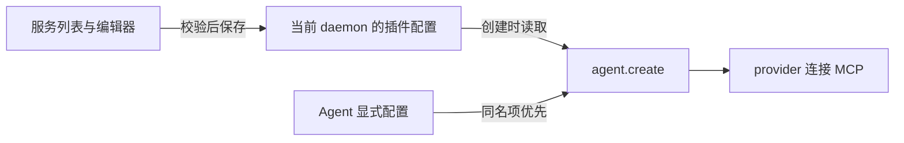

# MCP Manager 实施方案

状态：方案已确认，尚未开始功能实现。

正式规格以 [GitHub Issue #1](https://github.com/hulkzzhou1/paseo-mcp-manager/issues/1) 为准，已标记 `ready-for-agent`。

## 已确定的边界

- 基于社区版 Paseo 的公开插件接口，独立安装。
- 当前验证基线为社区版 `0.13.2`；首版可保守声明 `requirements.paseo >=0.13.2`，不承诺未验证的旧版本。
- 管理受管 MCP 服务的添加、编辑、删除和启用状态，提供表单与 JSON 编辑模式。
- 每个 daemon 保存自己的配置，连接凭据和内部服务定义留在本机。
- 首期覆盖 Codex（含自定义别名）和 Claude，凭据采用显式填写的 `headers` / `env`。
- 仅在 `agent.create` 时注入启用项。已有 Agent 保留自己的配置，不实时接收增删改或启停变化。
- Agent 显式配置的同名项整体覆盖管理器提供的定义，保持临时实现的合并顺序。
- 由 provider 直接连接服务，管理器不承载 MCP 代理或外部服务进程。

架构决策见 [ADR-0001](../adr/0001-community-plugin-and-new-agents.md)，术语见 [GLOSSARY.md](../../GLOSSARY.md)。

## 从临时实现继承什么

`iwiki-mcp` 已有 `agent.create` 注入和“Agent 显式配置优先”的基本行为。它没有管理界面或通用保存流程，连接列表和部分本机路径直接写在代码中，另有一项凭据在创建 Agent 时从本机文件读取。

沿用注入和合并行为，将硬编码定义改为读取受管 MCP 服务。临时实现追加的浏览器指引不属于 MCP Manager 的职责。Pi / OMP 的旧排除规则需要按社区版重新判断，不能直接当成当前能力结论。

## 最小实现

### 配置和保存

使用官方 `defineSettings`、`registerSettings` 和 `useSettings`，共享一份 Zod schema。以服务名称为键保存 `{ enabled, config }`；连接定义使用 Paseo 的标准形状，不引入额外服务 ID 或数据库。

- HTTP：`type`、`url`、可选 `headers`。
- stdio：`type`、`command`、可选 `args` 和 `env`。
- 保留标准可选字段 `alwaysLoad`，其效果由 provider 决定。
- 首版范围沿用 README 的 HTTP / stdio；SSE 暂不加入编辑入口。
- 校验非空名称、名称冲突、HTTP URL、非空命令和字符串键值对；预留宿主自身的 `paseo` 名称。
- 通过 revision 防止旧页面覆盖新保存的内容。冲突时保留编辑草稿，提示重新加载后处理。
- 无配置时使用空列表。无效文件保持原样并显示错误，不静默重置。
- token 直接填写在 `headers` / `env` 中，随官方 settings 以本机普通 JSON 保存，写入权限为 `0600`；管理器不读取额外的 token 文件。自动 settings RPC 会把完整 values 返回给编辑端。编辑时可以查看和替换原值，列表摘要与日志保持脱敏。
- 插件 reload、disable、daemon 重启保留 settings；卸载插件会删除该安装的 settings，需要在使用说明中明确。

### 管理界面

从侧边栏进入一个“服务列表 + 单服务编辑器”页面，复用 Paseo 的主题、紧凑布局和设置组件。

- 列表展示名称、传输类型、启用状态和编辑/删除操作，敏感值不进入摘要。
- 表单与 JSON 编辑同一个服务的标准连接定义，名称和启用状态独立编辑。
- 模式切换前校验内容；校验失败保留原草稿并定位错误，避免转换时丢字段。
- 启停是立即保存的配置操作；编辑在用户保存后提交；删除需要确认。
- 页面明确说明“配置变更仅对新建 Agent 生效”。保存成功表示定义已保存，不显示成连接成功。
- 首版保存只校验配置，不访问远端或执行 stdio 命令。日志、错误和列表不输出凭据。

### 创建时注入

每次 `agent.create` 先判断 provider 是否属于首期支持范围，再读取已保存配置，筛选启用项，随后合并 Agent 显式配置。保持其他请求字段和原对象不变，不追加 system prompt，不建立连接，也不注册 `agent.session_open` 更新逻辑。支持范围之外的 provider 保持原请求，避免未知兼容性影响 Agent 创建。

不维护跨创建操作的配置缓存或后台刷新任务。配置读取失败时保留原文件，按宿主插件错误机制报告失败，不重置成空配置。

### Provider 兼容性

社区版的 provider 查询接口没有注入前可用的 `supportsMcpServers` 能力字段，因此需要明确的兼容策略与真实验收。

- 首期验收 Codex 和 Claude。通过官方 daemon config 接口解析自定义 provider 的 `extends` 链，覆盖最终继承 Codex / Claude 的别名；循环引用或无法解析时跳过注入并报告原因。
- OMP 有 stdio / HTTP / SSE bridge，Pi 取决于安装的 builtin MCP 或 adapter；它们均留待后续兼容工作，不沿用临时实现的永久黑名单假设。
- 首期每个目标 provider 分别验证 HTTP / stdio；静态源码中有转换路径不等于真实连接已通过验收。

## 迁移和交接

实施时先在 daemon 本机迁移标准连接定义，仓库只保存无凭据的示例。用户直接把 token 填入配置中的 `headers` / `env`，并负责后续替换；管理器不读取额外的 token 文件，不执行凭据获取命令，也不提供 OAuth 登录或令牌刷新。

临时实现中依赖 token 文件的连接，在切换时改为直接填写配置值，不迁移原有文件读取逻辑。到期凭据需要手工替换，替换后的配置只对之后新建的 Agent 生效。

用新建 Agent 验证替代配置后，关闭 `iwiki-mcp` 中已迁移服务的注入；确认仍需使用的服务均有接入方式后，再停用整个临时插件。两个插件同时注入相同名称时，旧插件已加入请求的定义可能遮蔽管理器的编辑或停用效果，不能把双重注入当成最终运行方式。切换不改写已有 Agent 的配置。

## 验证与实施顺序

1. [#2：HTTP 服务首次可用](https://github.com/hulkzzhou1/paseo-mcp-manager/issues/2)：页面添加并保存 HTTP 服务，新建 Codex Agent 能调用工具。
2. [#3：HTTP 服务完整管理](https://github.com/hulkzzhou1/paseo-mcp-manager/issues/3)：编辑、JSON 模式、启停、删除及并发处理；依赖 #2。
3. [#4：stdio 服务完整管理](https://github.com/hulkzzhou1/paseo-mcp-manager/issues/4)：复用完整管理流程并验证本地工具调用；依赖 #3。
4. [#5：Claude、别名与切换验收](https://github.com/hulkzzhou1/paseo-mcp-manager/issues/5)：完成 provider 验收矩阵及本机迁移说明；依赖 #4。

主要通过 settings 保存接口和创建钩子验证外部行为：无效输入不覆盖原值；过期 revision 不覆盖新值；停用项不注入；同名显式项整体优先；Codex / Claude 别名正确处理；其他 provider 保持原请求；原请求不被修改。再验证保存后仅新建 Agent 使用新配置，已有 Agent 不变化。

集成验证使用无凭据的本地 HTTP / stdio 测试服务，逐项检查所选 provider 能调用工具，不用真实内部服务承担回归测试。

## 当前不安排

已有 Agent 的配置实时更新、Pi / OMP 等其他 provider 的首期支持、SSE 编辑入口、MCP 代理、动态 token 文件读取、OAuth 登录与令牌刷新、跨 daemon 同步、自动扫描或改写各 provider 的配置文件，以及持续连通性巡检。

## 依据

- 官方 [插件参考](https://paseo.sh/docs/plugins/reference.md)：公开钩子、设置持久化和界面能力。
- 本机社区版 `0.13.2` 的 plugin、protocol、provider 安装包：用于静态核查，尚未实测外部 MCP。
- 本机临时 `iwiki-mcp`：仅提取结构和行为，不将真实连接信息、凭据或本机命令路径复制进仓库。
